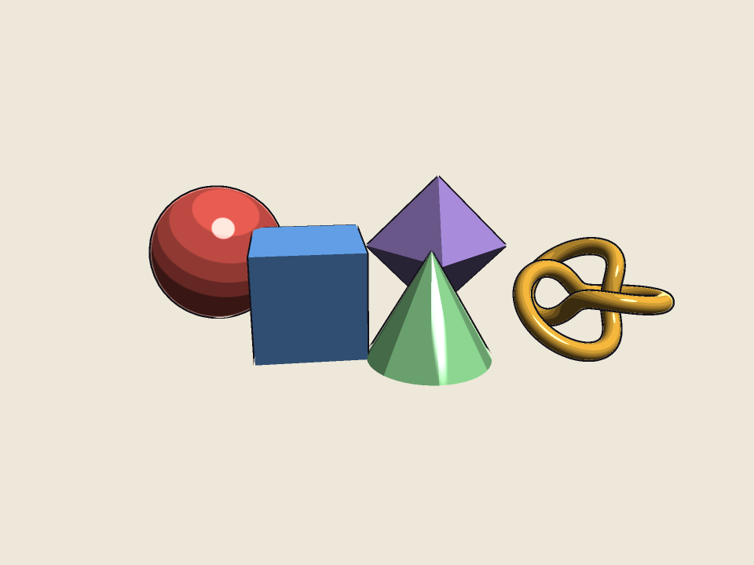
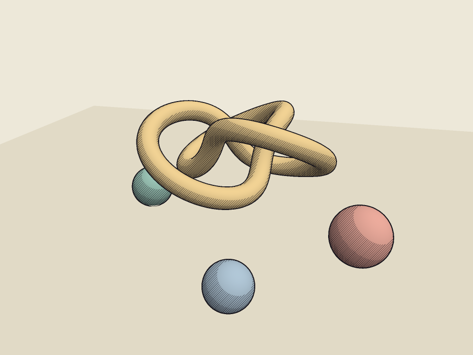
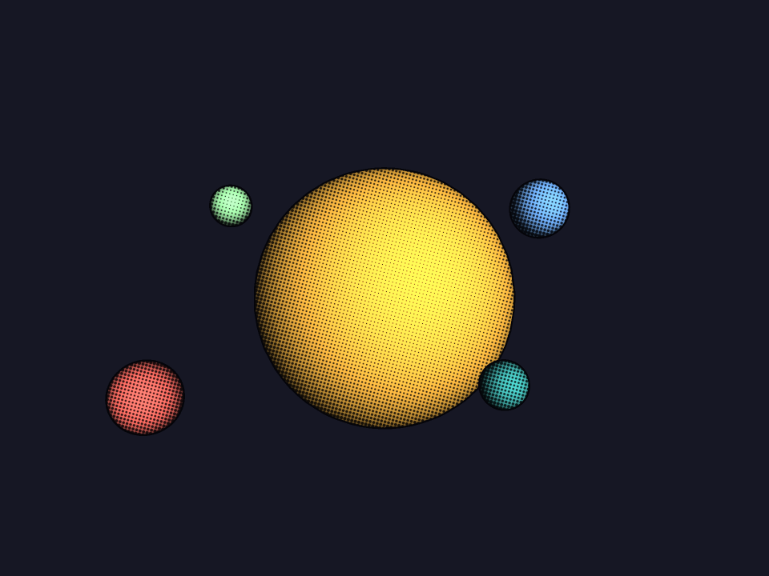
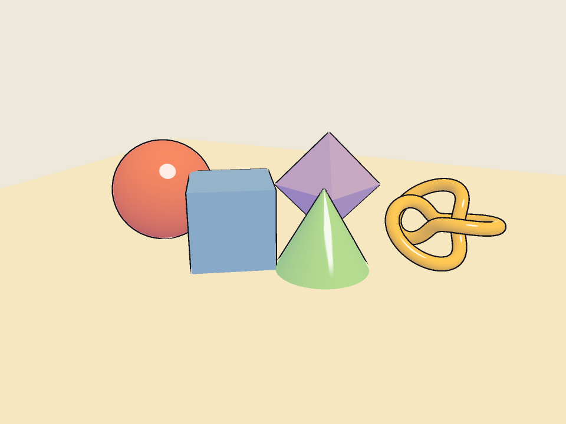
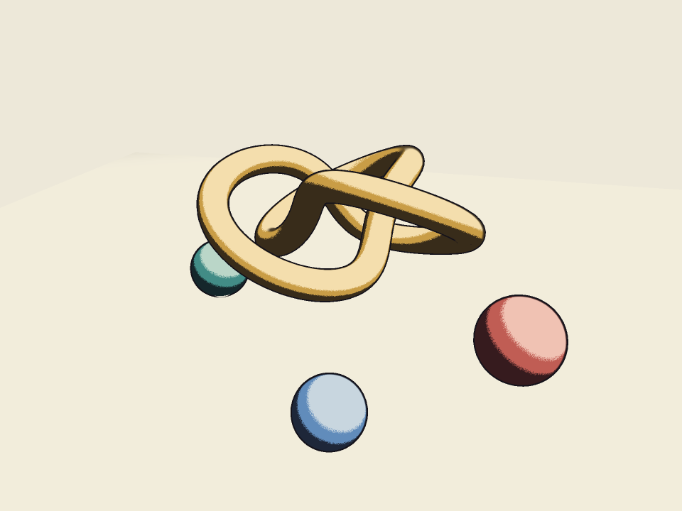
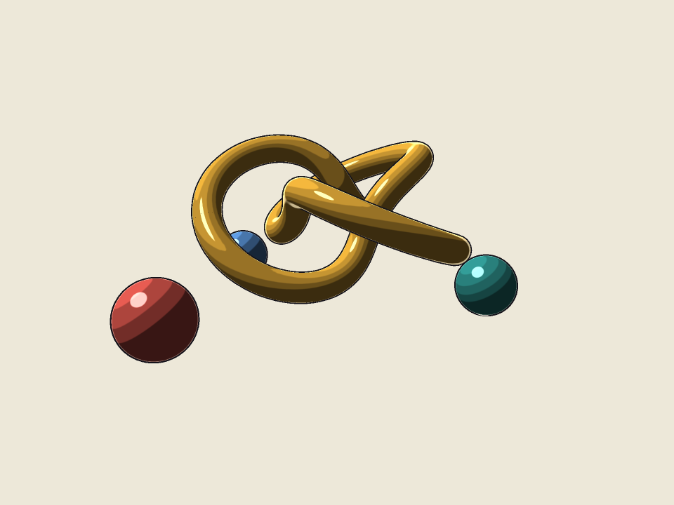

# Velora Engine

**A paint-first, non-photorealistic rendering (NPR) game engine written in modern C++20 on Vulkan.**

Velora treats the renderer as a set of *art materials* — cel shading, cross-hatching,
halftone print, ink wash, warm/cool illustration — rather than a physically-based
pipeline. Every frame is inked with distance-compensated inverted-hull outlines and
shaded by hot-reloadable GLSL shaders that the engine compiles to SPIR-V at startup
(no offline shader toolchain needed).

All renders in [`renders/`](renders/) were produced headlessly by the engine running
on a software Vulkan device (SwiftShader) — no GPU required.

## Showcase

| Toon (cel + rim + stepped specular) | Cross-hatch | Halftone |
|---|---|---|
|  |  |  |

| Gooch (warm/cool) | Ink wash | Turntable frame |
|---|---|---|
|  |  |  |

## Features

- **5 NPR shading styles** — `toon`, `gooch`, `hatch`, `halftone`, `ink` — each a full
  Vulkan graphics pipeline with its own GLSL fragment stage
- **Inverted-hull ink outlines** with distance compensation (constant screen-space width)
- **Runtime GLSL → SPIR-V** compilation via glslang; edit a `.frag` and re-run
- **Procedural geometry** — sphere, cube, cone, torus knot, crystal (octahedron), plane —
  generated on the CPU and staged into device-local buffers
- **Scene system** — nodes with transforms + rich materials (band count, specular,
  rim, outline width/color), directional key light, orbital camera
- **Headless offscreen rendering** — no window/surface required; 2x supersampled
  render target, box-filtered downsample, PNG export via stb
- **Runs on real GPUs and software Vulkan** (SwiftShader/lavapipe) alike

## Layout

```
src/
  main.cpp               CLI: showcase | render | list | info
  core/Log.hpp           logging
  vk/
    VulkanContext.*      instance, device, queue, one-shot commands
    Resources.{hpp,cpp}  buffers, images, staging
    ShaderLibrary.*      glslang: GLSL -> SPIR-V at runtime
    Pipeline.*           graphics pipeline builder
  render/
    Camera.hpp           orbital camera
    Mesh.*               procedural meshes + GPU upload/cache
    Scene.*              materials, nodes, the 3 demo scenes
    Renderer.*           render pass, NPR pipelines, PNG readback
shaders/                 GLSL sources (toon/gooch/hatch/halftone/ink/outline)
tools/fetch_deps.sh      one-shot dependency bootstrap
renders/                 engine output (the showcase matrix + turntable)
```

## Dependencies

| Component | Version | Role |
|---|---|---|
| Vulkan-Headers / Vulkan-Loader | `vulkan-sdk-1.3.296.0` | API headers + `libvulkan` |
| glslang | `vulkan-sdk-1.3.296.0` | runtime GLSL → SPIR-V |
| GLM | `1.0.1` | math |
| stb | master | PNG writer (`stb_image_write`) |
| SwiftShader ICD | npm `@onirenaud/swiftshader-vulkan` 0.1.0 | software Vulkan device (headless/CI) |

## Build & run

```bash
tools/fetch_deps.sh          # fetches + builds deps into build/ (cmake/ninja via pip if needed)
cmake -S . -B build/engine -G Ninja -DCMAKE_BUILD_TYPE=Release
cmake --build build/engine -j
```

Headless machine (no GPU) — point the loader at the bundled software ICD:

```bash
export VK_ICD_FILENAMES="$PWD/build/icd/package/linux-x64/vk_swiftshader_icd.json"
export LD_LIBRARY_PATH="$PWD/build/prefix/lib:$LD_LIBRARY_PATH"
./build/engine/velora showcase            # 23 renders into renders/
```

On a machine with a real Vulkan driver, skip the env vars and run `./build/engine/velora` directly.

## CLI

```
velora showcase [--out renders/] [--size 960x720] [--ssaa 2]
velora render --scene gallery --style toon --angle 40 --out shot.png
velora list        # scenes, styles, meshes
velora info        # Vulkan device details
```

Scenes: `gallery`, `knot`, `solar` · Styles: `toon`, `gooch`, `hatch`, `halftone`, `ink`

## Extending

- **New style:** drop `mystyle.frag` into `shaders/` (share `toon.vert`), register it in
  `styleList()` in `src/render/Renderer.cpp` — done.
- **New scene:** add a factory in `src/render/Scene.cpp` (nodes = mesh + transform + material).
- **New mesh:** add a `MeshData` generator in `src/render/Mesh.cpp` and a name in the
  `MeshStore` factory map.

## Roadmap

GLFW swapchain + interactive camera · OBJ/glTF loading · texture-driven paper grain ·
watercolor edge-wobble pass · compute-shader Kuwahara filter · animation/timeline system.
